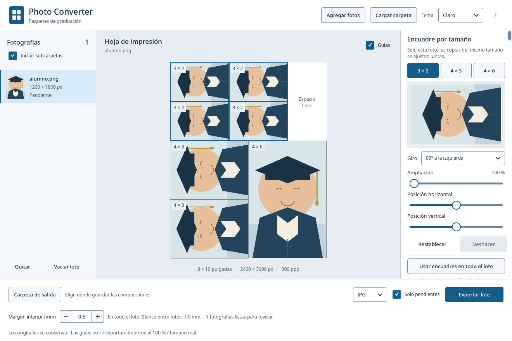
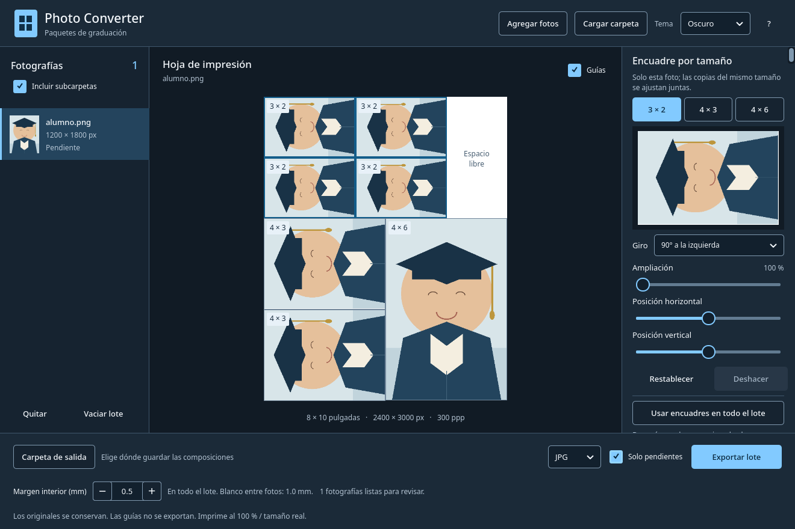

# Photo Converter

Aplicación de escritorio en español para preparar paquetes de fotografías de graduación. Carga una o varias fotos, o una carpeta con sus subcarpetas; ajusta el encuadre y exporta una hoja por imagen. Objetivo: Windows 10/11 de 64 bits. C++17 y Qt Quick 6; también se puede compilar en Linux.

## La plantilla

Cada archivo mide **8 × 10 pulgadas**, **2400 × 3000 píxeles**, a **300 ppp**:

| Copias | Tamaño | Posición |
|---|---|---|
| 4 | 3 × 2 pulgadas, horizontal | Dos filas y dos columnas arriba a la izquierda |
| 2 | 4 × 3 pulgadas, horizontal | Una sobre otra abajo a la izquierda |
| 1 | 4 × 6 pulgadas, vertical | Abajo a la derecha |

El área superior derecha de 2 × 4 pulgadas queda blanca. Al primer inicio se utiliza un margen blanco de **0.5 mm a cada lado de las líneas de corte interiores**, configurable. El último valor elegido se recupera en la siguiente apertura. Las fotografías que tocan la orilla de la hoja llegan hasta ella, sin margen exterior. Las guías y etiquetas de pantalla no se exportan. Las fotos se recortan para llenar el área interior de cada recuadro, conservando sus proporciones.

## Temas claro y oscuro

El selector **Tema**, en la barra superior, permite cambiar entre **Claro** y **Oscuro** sin reiniciar. La elección se guarda localmente y se recupera en la próxima apertura; el valor inicial es Claro.

Ambos temas definen colores propios para textos, checkboxes, campos numéricos, botones, selectores y sus menús, deslizadores, barras de desplazamiento, avisos y diálogos. Los controles tienen estados de foco y deshabilitado legibles. Las etiquetas pequeñas usan como mínimo 12 px.

La hoja y el encuadre conservan el blanco del papel en ambos temas. La apariencia de la aplicación no altera las imágenes ni los archivos exportados. Los selectores nativos de archivos y carpetas conservan la presentación del sistema operativo.



La paleta y sus comprobaciones están descritas en [Temas y contraste](docs/CONTRASTE.md).

## Uso

1. **Agregar fotos** permite seleccionar varios JPG/PNG. **Cargar carpeta** busca fotos en el directorio seleccionado; **Incluir subcarpetas** controla la búsqueda recursiva. También puedes arrastrar archivos y carpetas.
2. Selecciona un alumno en la lista. Elige **3 × 2**, **4 × 3**, **4 × 6** o **8 × 10**, y ajusta giro, ampliación y posición. La pestaña **8 × 10** muestra la foto individual en la vista grande y tiene un encuadre independiente. **Estos cambios afectan solo a la foto seleccionada.** También puedes arrastrar la vista del encuadre y usar la rueda para ampliar. Al pulsar una foto de la hoja se selecciona su tamaño.
3. **Usar encuadres en todo el lote** copia los cuatro ajustes, incluido el de 8 × 10 y sus giros, de la foto seleccionada a todas las fotos y a las que agregues después. Puedes corregir excepciones individualmente y deshacer los cambios.
4. La última **Carpeta de salida** se recupera al abrir la aplicación y al abrir su selector. Puedes cambiarla; si cargaste carpetas completas, el destino debe estar fuera de ellas. Selecciona JPG, PNG o PDF y pulsa **Exportar lote**.
5. Durante la exportación aparece una ventana con spinner, barra, porcentaje, contador de fotografías y nombre del archivo actual. Las demás acciones, los atajos y el cierre de la ventana quedan bloqueados; **Cancelar exportación** permite detener el lote y conserva los archivos terminados. **Solo pendientes** permite continuar durante la misma sesión sin repetir las fotos exportadas. Desmarca la opción para volver a exportar todas, por ejemplo en otro formato.
6. Al terminar aparece un aviso de exportación completada, cancelada o terminada con errores, con el número de archivos exportados y errores. Puedes **Abrir carpeta** o consultar **Ver detalles** si hubo fallos.

**Giro por tamaño:** cada tamaño tiene un selector independiente: Sin giro, 90° a la derecha, 180° y 90° a la izquierda. Por defecto, las copias de 3 × 2 y 4 × 3 giran 90° a la izquierda y las de 4 × 6 y 8 × 10 quedan sin giro. Puedes cambiar cada tamaño individualmente. Las posiciones y medidas de la plantilla se mantienen. El giro se aplica antes del recorte, tanto en la vista previa como en la exportación. Cambiar ampliación o posición conserva el giro; Restablecer vuelve a esos giros predeterminados.

**Adjuntar 8x10:** esta opción comienza desactivada. Al activarla, cada fotografía genera la composición habitual (`alumno_8x10.jpg`) y un segundo archivo con una sola foto de **8 pulgadas de ancho × 10 de alto**, **2400 × 3000 píxeles a 300 ppp**, sin márgenes (`alumno_foto_8x10.jpg`). El adjunto usa la orientación EXIF y su propio giro, posición y ampliación, definidos en la pestaña **8 × 10**. Comienza centrado, sin giro ni ampliación; los cambios en **4 × 6** no afectan a este encuadre. Puedes prepararlo con la opción desactivada y activar **Adjuntar 8x10** cuando quieras exportarlo. El recorte llena la proporción 8 × 10 sin deformar la foto. Se guarda en el mismo formato elegido (JPG, PNG o PDF) y conserva las subcarpetas. Cambiar la opción marca el lote como pendiente para que **Solo pendientes** incluya la nueva selección. El progreso cuenta fotografías; el resumen final cuenta los archivos guardados. Al cancelar se termina el par de la foto en curso y se conservan los archivos terminados.

**Margen de corte:** el control inferior **Margen interior (mm)** afecta a todas las hojas del lote, sin necesidad de usar Aplicar a todas. Comienza en 0.5 mm si aún no hay un valor guardado y permite valores de 0 a 10 mm en pasos de 0.1 mm, incluidos 0.1, 0.2, 0.3 y 0.4 mm; 0 elimina el margen. Los recuadros conservan sus medidas de corte de 3 × 2, 4 × 3 y 4 × 6 pulgadas. El blanco se reserva únicamente junto a las líneas interiores. No se agrega blanco en las orillas del papel; las fotos llegan al borde exterior y no requieren recortarlo. Un margen de 1 mm por lado deja 2 mm de separación entre fotos contiguas. El tamaño de la hoja sigue siendo 8 × 10 pulgadas. Cambiar el margen marca todas las fotos como pendientes para reexportarlas con el nuevo valor; Ctrl+Z permite deshacerlo. Se conserva al vaciar el lote y al cerrar y volver a abrir la aplicación. Deshacer y rehacer también actualizan el margen que se recuerda.

**Reutilizar fotos durante las pruebas:** puedes exportar una imagen, quitarla del lote y volver a agregar el mismo original, incluso si está junto a los archivos exportados. Una foto que ya está en el lote no se duplica; la aplicación lo indica. Los errores de carga aparecen en un aviso visible y en Ver detalles. Las búsquedas por carpetas excluyen la carpeta de salida para evitar reimportar paquetes; si necesitas un original que está allí, elígelo con Agregar fotos.

Una sesión mantiene los encuadres en memoria; todavía no guarda proyectos para retomarlos después de cerrar. Al cerrar con fotos pendientes aparece una confirmación. El tema, el margen y la última carpeta de salida sí se recuerdan entre sesiones. Si la carpeta guardada ya no está disponible, la aplicación pide elegir otra.

### Archivos y calidad

- Cada imagen genera su propio archivo, por ejemplo `Grupo A/alumno_001_8x10.jpg`. Las subcarpetas se conservan.
- Si el nombre ya existe, se añade `_2`, `_3`, etc. Se conservan tanto los originales como las exportaciones anteriores.
- Los archivos se escriben de forma atómica. Un fallo se muestra en pantalla y no detiene el resto del lote.
- La orientación EXIF se aplica automáticamente. Los perfiles de color incrustados se convierten a sRGB; las imágenes sin perfil se interpretan como sRGB. No hay retoque de piel, detección de rostros ni ajustes automáticos de exposición.
- La advertencia de resolución usa los píxeles que quedan después del recorte y la ampliación. Un archivo de salida a 300 ppp no recupera detalle perdido en una imagen pequeña.
- Se procesa una fotografía a la vez en segundo plano para mantener animado el progreso y limitar el consumo de memoria. El resto de la interfaz permanece bloqueado durante la exportación. No hay un máximo fijo de fotos.
- Los enlaces simbólicos de carpetas no se siguen durante la búsqueda. JPG/JPEG y PNG son los formatos de entrada de esta versión.

**Impresión:** usar papel de 8 × 10 pulgadas, escala **100 % / tamaño real**, sin ajustar a página. La plantilla llega a los bordes; la impresora debe admitir impresión sin bordes y evitar expansión automática. El PDF conserva las dimensiones físicas; en JPG/PNG el programa de impresión debe respetar los 300 ppp.

## Compilar en Windows

Requiere **Qt 6.8 o posterior**, kit de escritorio de 64 bits con Qt Quick y herramientas de desarrollo. La automatización usa Qt 6.8.3 y Visual Studio 2022 x64. También se admite el kit MinGW correspondiente a Qt.

Desde **Developer PowerShell for VS 2022 (x64)**, agrega al `PATH` el `bin` del kit Qt MSVC y ejecuta:

```powershell
git pull --ff-only origin main
$env:Path = 'C:\Qt\6.8.3\msvc2022_64\bin;' + $env:Path
.\scripts\build-windows.ps1
```

Ejecuta estos comandos desde la carpeta del repositorio. La primera vez, clónalo con `git clone https://github.com/monky-d-dev/photo-converter.git` y entra con `cd photo-converter`. Ajusta la ruta de Qt si tu kit está instalado en otra carpeta. Todo el código, las imágenes de prueba y los scripts necesarios están versionados; no hace falta trasladar un ZIP de fuentes desde Linux.

Para MinGW, abre la consola de Qt MinGW de 64 bits, con `qmake`, `windeployqt` y `mingw32-make` disponibles, y ejecuta el mismo script.

El script compila, ejecuta las pruebas, reúne las bibliotecas con `windeployqt` y prueba el paquete con un `PATH` sin Qt. El resultado es `dist/PhotoConverter-Windows-x64.zip`. Descomprime **todo** el ZIP en Windows y abre `photo-converter.exe`; la computadora del usuario no necesita tener Qt instalado.

La aplicación portátil también queda lista para abrir en `dist/PhotoConverter/photo-converter.exe`. Los archivos de compilación y los ZIP generados permanecen dentro de la carpeta del repositorio, en `build/windows/` y `dist/`, y están excluidos de Git. Después de cada actualización, vuelve a ejecutar el script para regenerar el paquete con los cambios nuevos.

El repositorio también incluye `.github/workflows/windows.yml`. Al ejecutarlo en GitHub Actions se genera el ZIP como artefacto descargable. No publica releases ni envía archivos a otros servicios.

Las pruebas guardan informes en `build/windows/tests/test-results.txt` y `test-results.xml`, y capturas en `build/windows/tests/captures/`. GitHub Actions los conserva en el artefacto **Windows-test-results**, incluso si alguna prueba falla. El script configura `QT_QPA_FONTDIR` con las fuentes de Windows para que las pruebas y capturas sin pantalla puedan mostrar los textos correctamente; si ya definiste esa variable, conserva tu directorio.

**Estado de esta entrega:** verificado en Linux con Qt 6.12 y en Windows con Qt 6.8.3 / MSVC 2022 x64: 36 resultados satisfactorios en cada sistema. La [ejecución de Windows del 13 de noviembre de 2026](https://github.com/monky-d-dev/photo-converter/actions/runs/43488639259) también comprobó el paquete desplegado y generó el ZIP portátil. El ZIP del código fuente no es un ejecutable de Windows.

## Desarrollo en Linux

Con Qt 6, qmake6, Qt Quick Controls, Qt Quick Dialogs, Qt Test, un compilador C++ y make:

```sh
bin/build
bin/test
build/photo-converter open
```

Para capturar la interfaz sin abrir una ventana en el escritorio:

```sh
QT_QPA_PLATFORM=offscreen QT_QPA_PLATFORMTHEME=generic QT_QUICK_BACKEND=software \
  build/photo-converter open docs/demo-portrait.png --capture docs/interfaz.png
```

## Atajos

| Teclas | Acción |
|---|---|
| Ctrl+O | Agregar fotografías |
| Ctrl+Shift+O | Cargar carpeta |
| Ctrl+Z | Deshacer encuadres |
| Ctrl+Shift+Z | Rehacer encuadres |
| Ctrl+Enter o Espacio | Exportar lote |
| ? | Ayuda |
| Q | Cerrar con confirmación si hay trabajo pendiente |

## Línea de comandos

Los comandos `check` y `export` no necesitan pantalla. `--json` devuelve resultados estructurados; los errores se escriben también en stderr y causan código de salida 1. El exportador CLI utiliza encuadres centrados con 3 × 2 y 4 × 3 giradas 90° a la izquierda y 4 × 6 sin giro; usa la interfaz para ajustarlos. En la CLI el margen de corte predeterminado es de 0.5 mm por lado solo en las líneas interiores, sin margen exterior, y se puede cambiar con `--margin-mm` (0 a 10, en pasos de 0.1 mm). La interfaz gráfica recupera su último margen guardado.

```powershell
.\photo-converter.exe check 'C:\Fotos\Grupo A' --recursive --json
.\photo-converter.exe export 'C:\Fotos\Grupo A' --recursive --output 'C:\Paquetes\Grupo A' --format jpg --margin-mm 0.3 --json
.\photo-converter.exe export 'C:\Fotos\alumno.png' --output 'C:\Paquetes' --format pdf --json
```

Se incluye una habilidad para agentes, instalable únicamente al solicitarlo:

```sh
photo-converter skill install --output /ruta/a/skills --json
```

## Pruebas

La apariencia se comprueba en los dos temas, incluyendo cambio de tema y persistencia, colores de checkboxes y del margen, menús, ayuda, controles deshabilitados, foco, contraste y exportación sin cambios visuales.

La suite cubre márgenes físicos y pasos de ajuste, cambios de margen en todo el lote sin modificar giros individuales, medidas y posiciones de las siete fotos, área blanca, proporciones, orientación EXIF, calidad efectiva después del giro, rotaciones independientes por tamaño, carpetas y duplicados, escritura de JPG/PNG/PDF, errores, cancelación, un lote real de 50 archivos, encuadres comunes, deshacer/rehacer, reanudación de pendientes y manejo de la interfaz QML con ratón y teclado.

También comprueba el progreso creciente, los resúmenes de éxito y errores, y el bloqueo de clics, atajos y cierre durante la exportación de 50 fotos, con cancelación y aviso final en ambos temas.

La ilustración de `docs/demo-portrait.png` es contenido ficticio de prueba; no contiene fotografías de alumnos.
